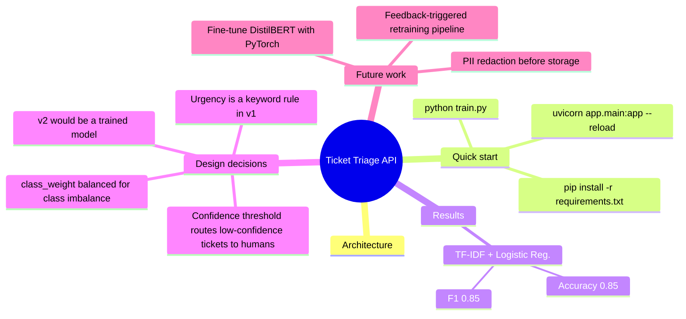
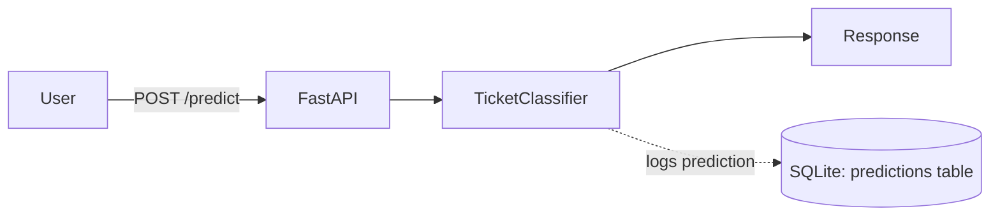

# Ticket Triage API

An ML system that classifies incoming support tickets by **category** and **urgency**, served over a REST API, with every prediction logged to SQL.

## Overview



## Architecture



## Quick start

```bash
pip install -r requirements.txt
python train.py
uvicorn app.main:app --reload
```

Then open http://127.0.0.1:8000/docs

## Results

| Model                  | Accuracy | F1   |
|------------------------|----------|------|
| TF-IDF + Logistic Reg. | 0.85     | 0.85 |

## Design decisions

- `class_weight='balanced'` to handle class imbalance
- Confidence threshold → route low-confidence tickets to humans (roadmap)
- Urgency is a keyword rule in v1; v2 would be a trained model

## Future work

- Fine-tune DistilBERT with PyTorch for better accuracy
- Feedback-triggered retraining pipeline
- PII redaction before storage